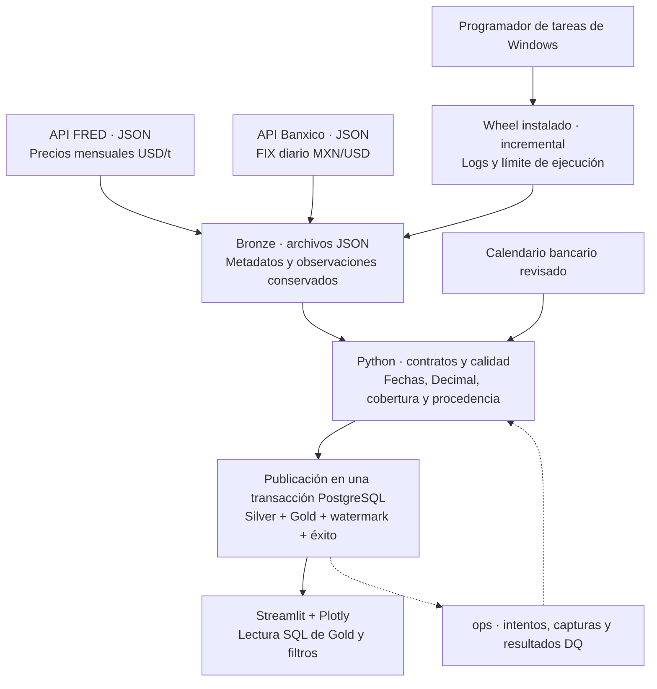
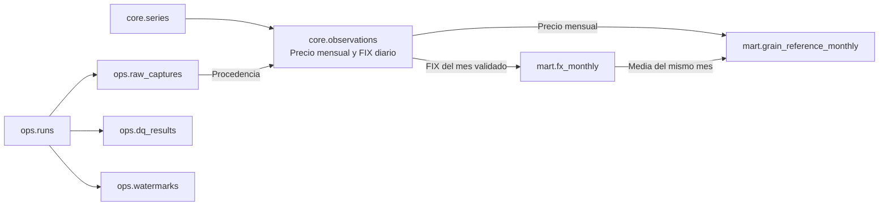

# Justificación del diseño: integración FRED–Banxico

**Proyecto:** Referencias mensuales de maíz, trigo y soya en pesos mexicanos.
**Propósito:** Explicar cómo se integraron las fuentes, por qué se eligieron las herramientas y cómo las decisiones de diseño sostienen las cargas y el análisis.

## 1. Problema que resuelve el proyecto

El proyecto combina los precios mensuales de maíz, trigo y soya de FRED (`PMAIZMTUSDM`, `PWHEAMTUSDM` y `PSOYBUSDM`), expresados en USD por tonelada, con el FIX diario de determinación de Banxico (`SF43718`), expresado en MXN por USD.

La pregunta es cómo cambia una referencia de estos granos en pesos cuando varían su precio internacional y el tipo de cambio:

**Referencia mensual MXN/t = precio mensual USD/t × promedio mensual FIX MXN/USD.**

La primera decisión fue resolver la diferencia de frecuencias antes de relacionar las series. Para calcular el promedio FIX se exige que las fechas recibidas coincidan con el calendario bancario revisado del mes. Tener suficientes filas por conteo no basta: deben ser los días esperados.

## 2. Arquitectura y recorrido de los datos

### Diseño de la arquitectura

Se separó la conservación de las respuestas, la publicación de datos válidos y la consulta analítica. Ambas fuentes se consultan mediante APIs JSON. Bronze conserva el contenido JSON interpretado y el contexto de extracción, incluidos los textos numéricos originales. Cada captura registrada tiene una ruta y un SHA-256 que permite comprobar su integridad.

Las funciones Python validan los contratos de las fuentes y preparan fechas y valores decimales. Silver se almacena en `core.observations`. Gold contiene el promedio FIX en `mart.fx_monthly` y las referencias por grano en `mart.grain_reference_monthly`.

La publicación confirma Silver, Gold, watermark y estado exitoso en una sola transacción. Si falla, se revierte ese conjunto. Los registros operativos previos y las capturas permanecen para diagnosticar o recuperar el intento. Esta separación entre capas lógicas y control permite seguir un resultado hasta sus entradas sin convertir los archivos locales en parte de una transacción SQL.

El dashboard consulta el producto publicado con SQL y no llama a las APIs. El histórico inicial, el incremental, el reproceso y la recuperación tienen comandos propios y comparten las reglas y transformaciones. Windows programa únicamente el incremental del paquete instalado.

## 3. Diseño del modelo de base de datos

### 3.1. El punto de partida: frecuencia, precisión y procedencia

La muestra inicial conservada contenía nueve precios mensuales y 21 observaciones FIX. El perfilamiento identificó valores FRED con hasta 13 posiciones decimales y fechas únicas por serie. Estas observaciones llevaron a conservar la fecha y el valor de cada fuente, utilizar `NUMERIC` sin una escala fija y separar el cálculo mensual de los datos de origen.

El esquema implementado tiene **ocho tablas del modelo**, más `ops.schema_migrations` como control técnico de versión:

| Tabla | Qué representa una fila | Papel en el diseño |
|---|---|---|
| `core.series` | Una serie de un proveedor | Catálogo con identidad, unidad y frecuencia |
| `core.observations` | Una observación por proveedor, serie y fecha | Silver vigente con procedencia |
| `mart.fx_monthly` | Un mes de una serie FIX | Promedio y cobertura bancaria certificada |
| `mart.grain_reference_monthly` | Un mes de una serie de grano | Entradas de cálculo, referencia MXN/t, MoM y YoY |
| `ops.runs` | Un intento de ejecución | Modalidad, etapa, estado e instantes |
| `ops.raw_captures` | Una captura registrada | Archivo, contexto, hash y ejecución de origen |
| `ops.dq_results` | Una evaluación de calidad | Regla, estado y métricas |
| `ops.watermarks` | El avance del producto mensual | Intervalo publicado y ejecuciones que lo respaldan |

### 3.2. Relaciones que sostienen el cálculo

Las flechas resumen relaciones y dependencias de cálculo. El [modelo de datos](../docs/MODELO_DATOS_ES.md) y el [diccionario](../docs/DICCIONARIO_DATOS_ES.md) detallan las claves y restricciones físicas.

La clave de Silver es `(provider, series_code, observation_date)`. En FRED, el primer día identifica el periodo mensual. En FIX, la fecha identifica un día de determinación. La unidad y frecuencia del catálogo permiten interpretar ambos casos sin crear tablas de observaciones distintas para cada proveedor.

Una nueva captura del mismo dato actualiza la fila vigente solo si cambia su valor. Bronze y los registros operativos conservan la evidencia anterior. En Gold, guardar precio, media FIX y referencia permite conciliar la multiplicación utilizada, mientras el promedio mensual mantiene su propio registro de cobertura.

### 3.3. Por qué el modelo no es una estrella clásica

El modelo es **relacional por capas, con tablas de resultados orientadas al análisis**. `core.series` aporta contexto compartido, pero no existen dimensiones físicas de fecha o de producto ni tablas `fact_*` y `dim_*`.

Elegí este diseño porque el trabajo incluye tanto construir indicadores como controlar revisiones, capturas y ejecuciones. Una estrella de consumo resolvería la consulta de medidas, pero todavía necesitaría el registro operativo y la procedencia. Aquí, el catálogo identifica los cuatro conjuntos de observaciones y el mes relaciona los resultados, sin añadir dimensiones que no requiere la consulta implementada.

La fecha se almacena directamente y las funciones de calendario obtienen los periodos de comparación. El calendario bancario revisado se conserva como recurso anual para certificar la cobertura FIX. Esta función de validación es distinta de la agrupación temporal que suele ofrecer una dimensión de fecha.

El mart conserva algunas entradas del cálculo junto al resultado. Esa redundancia es deliberada: facilita verificar cada referencia y servirla al dashboard. El diseño se describe mejor como un modelo relacional con un mart analítico que como una estrella parcialmente implementada.

## 4. Por qué PostgreSQL

El almacenamiento debía coordinar las escrituras del pipeline y las lecturas del dashboard, publicar datos y avance en una misma transacción y aplicar restricciones relacionales entre series, observaciones y capturas. Elegí PostgreSQL para cubrir esos requisitos con un servicio compartido por ambos procesos. Las claves y restricciones protegen la identidad de los registros, y `INSERT ... ON CONFLICT` permite mantener el estado vigente durante las revisiones.

La necesidad más importante fue publicar datos y avance juntos. Si se escribiera Gold y después fallara la actualización del watermark, el dashboard y la siguiente carga podrían interpretar estados distintos. La [transacción de publicación](https://www.postgresql.org/docs/18/tutorial-transactions.html) agrupa esos cambios. Un bloqueo de sesión serializa las publicaciones mientras las consultas HTTP se realizan sin una transacción SQL abierta.

El dashboard abre una transacción `REPEATABLE READ, READ ONLY`: watermark y filas analíticas pertenecen a la misma instantánea. Así, una carga concurrente no mezcla el avance de una publicación con los datos de otra.

| Alternativa | Por qué PostgreSQL encajó mejor en esta implementación |
|---|---|
| SQLite | Puede cubrir el volumen actual. Se eligió un servicio de base de datos para centralizar el acceso de cargas y dashboard, sin coordinar entre ambos el acceso a un archivo local. |
| DuckDB | El centro del diseño es mantener el producto y su control operativo entre procesos. PostgreSQL concentra esas escrituras y ofrece al dashboard la consulta SQL sobre el mismo estado publicado. |
| Databricks / Delta Lake | Para cuatro series y 5,102 observaciones Silver registradas, elegí procesamiento local y un servicio relacional, en lugar de incorporar un entorno distribuido. |

El volumen actual también podría resolverse con otras opciones. La elección responde a la coordinación entre procesos, la publicación transaccional y los controles relacionales requeridos. Las [restricciones implementadas](https://www.postgresql.org/docs/18/ddl-constraints.html) complementan las comprobaciones de conjuntos que ejecuta Python, como cobertura bancaria y continuidad de meses.

## 5. Bibliotecas utilizadas

El uso combinado de Python y SQL permite mantener las reglas del negocio separadas de la interfaz y de los detalles de conexión.

Las transformaciones utilizan funciones Python y `Decimal` para conservar los valores decimales y controlar el redondeo.

| Herramienta | Por qué se utiliza y dónde interviene |
|---|---|
| `requests` | Consulta las APIs mediante sesiones reutilizables. El cliente comparte autenticación, validación de respuestas y política de reintentos entre las cargas. |
| `Decimal` y `NUMERIC` | Conservan los valores decimales de origen y una política común de cálculo. Las funciones usan 34 dígitos significativos y `ROUND_HALF_EVEN`, con conversión a `float` limitada a la representación gráfica. |
| `psycopg[binary]` | Conecta Python con PostgreSQL y permite controlar transacciones, consultas parametrizadas y tipos decimales. La distribución binaria facilita la instalación en Windows. |
| `python-dotenv` | Lee la configuración privada desde una ruta explícita. Las variables del proceso tienen prioridad y cada componente solicita solo las claves que necesita. |
| `zoneinfo` y `tzdata` | Determinan el cierre de mes en `America/Mexico_City`. `tzdata` proporciona la referencia IANA cuando el sistema no la ofrece. |
| `pathlib`, `json` y `hashlib` | Gestionan rutas, capturas JSON y comprobaciones SHA-256 sin añadir dependencias de almacenamiento. |
| `unittest` y `unittest.mock` | Verifican reglas y fallos con datos ficticios, HTTP simulado y bases PostgreSQL desechables. |
| `setuptools`, `wheel` y `build` | Empaquetan el código, SQL y calendarios para instalar el proceso fuera del checkout. Se declaran como herramientas de construcción, separadas de la ejecución programada. |

La elección de aritmética decimal responde a la precisión observada en el perfilamiento. La [biblioteca estándar documenta](https://docs.python.org/3.12/library/decimal.html) el control de precisión y redondeo que aprovecha esta implementación. El detalle de dependencias y entradas de consola se conserva en [pyproject.toml](../pyproject.toml).

## 6. Streamlit y Plotly para el análisis

El dashboard debía permitir seleccionar periodo y grano, actualizar la lectura desde PostgreSQL y explorar tres preguntas conectadas. Elegí Streamlit para construir esos controles en el mismo lenguaje de las reglas y Plotly para las líneas, barras y herramientas de interacción.

La separación está en el código: `app/queries.py` obtiene la instantánea SQL, `app/analytics.py` calcula indicadores con `Decimal`, `app/charts.py` construye las figuras y `app/streamlit_app.py` organiza la interfaz. Las consultas se hacen sobre las tablas publicadas y el catálogo, sin depender de vistas SQL adicionales.

Power BI habría permitido desarrollar una capa de BI separada. Para esta entrega, Streamlit facilitó integrar filtros, mensajes de validación e indicadores con las funciones Python existentes y comprobar la aplicación mediante AppTest. Frente a un notebook, ofrece una interfaz que el consumidor puede recorrer sin ejecutar celdas. Su [arquitectura cliente-servidor](https://docs.streamlit.io/develop/concepts/architecture/architecture) permite consultar el dashboard desde el navegador.

### Capturas de la aplicación

Las tres capturas de [Entregables/Capturas](Capturas) muestran **enero de 2009 a septiembre de 2026**, con 213 meses.

**Precio internacional y referencia en pesos.** Los índices parten de cien en el primer mes seleccionado. La captura de maíz muestra una referencia final de $4,090.12 MXN/t, FIX medio de 17.2640 y cambio acumulado de +69.90%.

**Contribución de cada factor.** Las barras separan el cambio mensual asociado al precio internacional y al FIX. La atribución reparte simétricamente el término de interacción y puede mostrarse en puntos porcentuales o MXN/t.

**Comparación entre granos.** En el periodo de las capturas, los cambios acumulados son +69.90% para maíz, +64.1% para soya y +45.20% para trigo. La tabla inferior cuenta los meses con caída internacional cuyo ahorro no se refleja en la referencia en pesos. El primer mes del histórico queda sin comparador previo.

El [informe analítico](../docs/RESULTADOS_ANALISIS_ES.md) utiliza 2010-01 a 2026-09 y registra +90.93%, +98.36% y +80.97% para maíz, trigo y soya, respectivamente. Se conservan ambos alcances con sus fechas: cambiar el mes inicial cambia la base y los resultados.

## 7. Decisiones operativas y controles

| Decisión | Problema que resuelve |
|---|---|
| Capturar antes de validar observaciones | Conserva la respuesta recibida incluso cuando su estructura o contenido bloquea la carga. |
| Comparar fechas FIX con un calendario revisado | Evita aceptar un mes incompleto por tener un conteo aparentemente suficiente. |
| Histórico e incremental independientes | La inicialización exige ausencia de watermark. Las actualizaciones parten del producto ya publicado. |
| Revisar tres meses publicados por defecto | Detecta correcciones recientes con una ventana configurable de cero a doce meses. Las correcciones más antiguas utilizan el reproceso explícito. |
| Reconstruir Gold desde Silver validado | Conserva comparadores mensuales y anuales exactos. Solo se escriben las filas cuyos valores cambian. |
| Recuperación bajo bloqueo | Reutiliza capturas completas e íntegras mediante un intento nuevo cuando el estado permite hacerlo con seguridad. |
| Wheel y Programador de tareas de Windows | Ejecutan el incremental instalado con rutas explícitas, logs por intento, código de salida y límite de duración. El entorno programado no necesita Streamlit ni Plotly. |

## 8. Resultado y alcance de la solución

La [evidencia de estado](../docs/evidencias/entrega_final/estado_real.json) registra 5,102 observaciones Silver, 213 medias FIX y 639 referencias Gold para 2009-01 a 2026-09. Son los resultados sobre los que se apoya el análisis, junto con los controles de procedencia y cobertura.

Se ejecutaron y aprobaron **259 pruebas: 168 sin servidor y 91 de integración PostgreSQL**, sin fallos, errores ni omisiones. El [resumen de resultados](../docs/evidencias/entrega_final/resumen_pruebas.json) registra los resultados; el [catálogo de pruebas](../docs/CATALOGO_PRUEBAS_ES.md) explica sus 32 módulos y enumera cada caso. Las pruebas utilizan bases desechables y HTTP simulado. Las comprobaciones del wheel, el scheduler y el producto real se detallan en el [proceso de implementación](../docs/Implementación_proceso.md).

### Límites y condiciones de operación

La referencia es nominal y excluye fletes, seguros, aranceles y condiciones comerciales. La atribución es matemática y no demuestra causalidad económica. Para operar las cargas deben estar disponibles PostgreSQL y Bronze, y la tarea de Windows requiere una sesión iniciada. Los calendarios revisados cubren 2009–2026, por lo que publicar un año posterior exige incorporar su referencia bancaria. La evidencia de un preflight programado de solo lectura no equivale a una carga incremental ejecutada por el scheduler.

### Cierre

La decisión central fue conservar las observaciones con su frecuencia y procedencia, y publicar después un producto mensual consistente. PostgreSQL sostiene las relaciones y las actualizaciones, Python comparte las reglas entre cargas y Streamlit permite explorar el resultado publicado. Se evitó incorporar procesamiento distribuido porque el volumen actual puede resolverse con Python y PostgreSQL.

## Documentación del proyecto

- [Modelo de datos y contrato de publicación](../docs/MODELO_DATOS_ES.md).
- [Diccionario de las tablas implementadas](../docs/DICCIONARIO_DATOS_ES.md).
- [Perfilamiento inicial y precisión observada](../docs/Perfilamiento_inicial.md).
- [Análisis y dashboard](../docs/ANALISIS_Y_DASHBOARD_ES.md).
- [Operación y recuperación](../docs/RUNBOOK_ES.md).

Las fuentes de datos son FRED y Banco de México. El apoyo de IA en código y documentación se reconoce en el README del proyecto.
