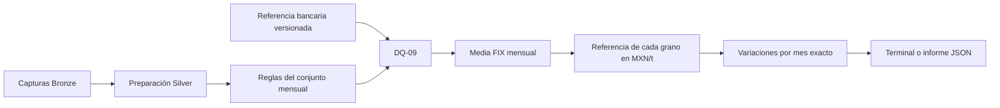

# Calendario bancario y transformaciones Gold

## 1. Propósito de este paso

Silver conserva observaciones válidas con tipos comunes. Gold necesita comprobar además que esas observaciones forman un periodo completo y combinar sus unidades y frecuencias.

FRED entrega precios mensuales en USD/t. Banxico entrega FIX de determinación en MXN/USD por día hábil bancario. Se calcula la media FIX del mes y se multiplica por cada precio mensual para obtener una referencia en MXN/t.

Esta guía explica las reglas y los cálculos compartidos por las cargas. El comando de vista previa trabaja con archivos locales y en memoria, la [persistencia Gold y la publicación transaccional](GUIA_PUBLICACION_GOLD_ES.md) utilizan esas mismas funciones dentro de los coordinadores.

## 2. Archivos y responsabilidades

| Archivo o paquete | Responsabilidad |
|---|---|
| `sources/calendars/2026.json` | Referencia revisada: cierres, fines de semana, versión, fechas de revisión y fuentes. |
| `sources/calendars/2009.json` a `2025.json` | Referencias históricas incorporadas al preparar la carga completa, con su propia procedencia. |
| `sources/banking_calendar.py` | Lectura del recurso anual y generación de las fechas bancarias esperadas. |
| `quality/calendar.py` | Regla `DQ-09`: comparación del FIX utilizable contra esas fechas. |
| `quality/gold.py` | Tipos Silver, claves únicas, meses cerrados y precios completos de los tres granos. |
| `common/decimal_policy.py` | Precisión y redondeo compartidos para Gold. |
| `common/dates.py` | Enumeración de meses y operaciones de calendario. |
| `transformations/monthly_fx.py` | Media FIX de un mes con cobertura aprobada. |
| `transformations/gold.py` | Referencias MXN/t y variaciones mensual y anual. |
| `transformations/gold_preview.py` | Lectura de la muestra, ejecución de las funciones y salida por terminal o JSON. |
| `tests/test_banking_calendar.py`, `tests/test_gold.py` | Escenarios de calendario, cálculos, revisiones y muestra archivada. |

Los archivos permanecen en la estructura propuesta por el plan. Los `__init__.py` identifican los paquetes y describen su contenido. No se agregaron clases propias ni dependencias nuevas. Las reglas DQ pueden ejecutarse y probarse sin llamar APIs ni abrir PostgreSQL.



## 3. Calendario independiente de los datos recibidos

[Banxico](https://www.banxico.org.mx/apps/dao-web/4/52/tipo-cambio-equilibrio001.html) distingue la fecha de determinación del FIX de su publicación posterior en el DOF y señala que se da a conocer en días hábiles bancarios. El catálogo utiliza `SF43718`, correspondiente a determinación.

El recurso 2026 se sustentó en las disposiciones de cierre de entidades financieras de la CNBV, [publicadas en el DOF el 10 de diciembre de 2025](https://sidof.segob.gob.mx/notas/5775684). Las fechas se cotejaron con la [relación publicada por la Asociación de Bancos de México](https://m.abm.org.mx/dias-feriados/). Se excluyen sábados, domingos y las siguientes fechas de 2026:

```text
01-01, 02-02, 03-16, 04-02, 04-03, 05-01,
09-16, 11-02, 11-16, 12-12 y 12-25.
```

No se trasladan cierres a otros días por iniciativa del programa. Por ejemplo, el 12 de diciembre de 2026 cae en sábado y no convierte el lunes 14 en inhábil.

El archivo conserva la versión `mx-banking-2026-v1`. La lectura calcula su SHA-256 con saltos de línea normalizados y forma `calendar_reference` con versión y hash. Así puede identificarse el recurso exacto que respaldó el agregado. Una corrección requiere revisar la fuente, actualizar la versión y conservar el cambio en Git.

La primera vista previa incorporó la referencia anual de 2026. La carga histórica añadió las de 2009–2025, la [guía histórica](GUIA_CARGA_HISTORICA_ES.md) documenta su procedencia y cierres extraordinarios. Los recursos actuales cubren 2009–2026. Un año sin recurso devuelve cobertura `pending` y bloquea el agregado, requiere una referencia revisada propia. El sistema no copia las reglas de 2026 hacia otros años.

## 4. Qué comprueba DQ-09

`check_fix_coverage` recibe registros Silver y un mes. Devuelve un diccionario con código, estado y métricas, compatible con la representación usada para registrar resultados DQ.

La evaluación compara las fechas esperadas con las fechas que tienen un FIX `Decimal`, finito y positivo, de la serie correcta. Identifica fechas ausentes, inesperadas y duplicadas, además de registros incompatibles. Exige igualdad de conjuntos y ausencia de incidencias.

Por ejemplo, cambiar el registro del 1 de septiembre por otro del 16 mantiene 21 filas, pero produce un faltante y una fecha inesperada. La regla falla. Tampoco aprueba una fecha repetida aunque el conjunto de fechas únicas coincida.

El perfil de una captura sigue informando `pending_banking_calendar`: ese perfil no decide si se reunió el mes completo. La comprobación mensual posterior queda en `quality/calendar.py`. Las evidencias iniciales y sus resultados previos se conservan sin reescribirlos.

## 5. Cómo se calculan las referencias

Para cada mes del intervalo, `build_monthly_gold` exige los tres precios y certifica el FIX. No omite meses, descarta filas inválidas ni interpola ausencias. También rechaza claves repetidas entre los registros reunidos desde distintas capturas.

```text
average_fix = suma de FIX diarios / días bancarios esperados
reference_mxn_t = grain_price_usd_t × average_fix
```

`aggregate_monthly_fix` devuelve la media que después se utiliza en las tres referencias. La persistencia conserva exactamente esa misma entrada en `mart.fx_monthly` y en `mart.grain_reference_monthly`.

Los cálculos usan un contexto decimal local de 34 dígitos significativos y `ROUND_HALF_EVEN`. La precisión no significa 34 posiciones después del punto. `Context` y `localcontext` pertenecen a la biblioteca estándar: activan la política dentro del cálculo y restauran el contexto del llamador al salir. Los valores originales de Silver se conservan.

Las variaciones se calculan con fechas exactas:

```text
MoM % = (referencia actual / referencia del mes anterior - 1) × 100
YoY % = (referencia actual / referencia del mismo mes del año anterior - 1) × 100
```

Pueden ser cero o negativas. En la vista previa son nulas cuando su comparador queda antes del intervalo calculado. Un hueco interior impide calcular el intervalo. En las cargas, el publicador reconstruye Gold desde todo el intervalo Silver publicado, combinado con las entradas nuevas, conserva los comparadores y escribe solo los resultados que cambian. Empezar el cálculo en el primer mes revisado perdería comparadores existentes.

Las pruebas incluyen una revisión ficticia de agosto: cambia su referencia y también la variación de septiembre. La política exige reconstruir esas dependencias antes de publicar una revisión.

## 6. Resultado de la muestra real archivada

La vista previa de septiembre de 2026 validó las capturas completas y seleccionó tres precios y 21 FIX: 24 observaciones para ese mes. Las seis observaciones FRED de julio y agosto permanecen en sus capturas, pero no son entradas de esta vista previa porque la muestra FIX solo cubre septiembre.

`DQ-09` aprobó 21 fechas esperadas y 21 recibidas, sin fechas ausentes, inesperadas o repetidas. La media fue `17.26401904761904761904761904761905` MXN/USD.

| Grano | Referencia septiembre de 2026, MXN/t |
|---|---:|
| Maíz | 4,090.12 |
| Trigo | 4,261.65 |
| Soya | 8,316.46 |

La tabla redondea para lectura, el [informe JSON](evidencias/calendario_gold/vista_previa.json) conserva los valores calculados completos, los hashes de las cuatro capturas y la evidencia del calendario. MoM y YoY quedan nulos en esta vista previa de un mes. No se consultaron APIs ni se escribieron datos en PostgreSQL.

La certificación del calendario y los cálculos acreditan esta muestra. La publicación del producto añade las verificaciones de procedencia, el registro operativo y la transacción completa hasta watermark, implementados en los coordinadores y el publicador compartido.

## 7. Comandos para revisar el paso

Desde la raí del repositorio, ejecutar las pruebas:

```powershell
python -X utf8 -m unittest discover -s tests -v
```

La [verificación registrada de esta etapa](evidencias/calendario_gold/validacion.json) descubrió 130 casos: ejecutó 108 sin fallos ni errores y omitió los 22 de PostgreSQL al no proporcionar conexión de prueba. Incluye 22 casos nuevos de calendario y Gold. Los 22 SQL conservaron su [validación previa en una instancia aislada](evidencias/persistencia_silver/validacion.json), no se volvieron a ejecutar en ese paso. Es un recuento histórico: la [validación final](VALIDACION_FINAL_ES.md) registra la suite ampliada con toda la integración ejecutada. `unittest` no carga `.env`, la [guía PostgreSQL](GUIA_POSTGRESQL_ES.md) explica el ejecutor explícito.

Para usar la última muestra local completa:

```powershell
python -X utf8 -m grain_pipeline.transformations.gold_preview --month 2026-09
```

Para reproducir el resultado usando las capturas versionadas:

```powershell
python -X utf8 -m grain_pipeline.transformations.gold_preview --month 2026-09 --sample-dir docs/evidencias/perfilamiento_inicial --bronze-root docs/evidencias/perfilamiento_inicial
```

El comando permite exportar un informe nuevo con `--output`. Su carpeta debe existir y el archivo no debe existir:

```powershell
New-Item -ItemType Directory -Path data -Force | Out-Null
python -X utf8 -m grain_pipeline.transformations.gold_preview --month 2026-09 --sample-dir docs/evidencias/perfilamiento_inicial --bronze-root docs/evidencias/perfilamiento_inicial --output data/vista_previa_gold_2026-09.json
```

No es necesario reinstalar `requirements.txt`. Si las comprobaciones terminan correctamente, revisar y guardar:

```powershell
git status --short
git add grain_pipeline tests docs README.MD
git diff --cached --stat
git commit -m "feat: validate banking calendar and calculate monthly Gold references"
git status
```

## 8. Continuidad

La [publicación coordinada](GUIA_PUBLICACION_GOLD_ES.md) persiste las capas y se comprobó con pruebas transaccionales. El [histórico](GUIA_CARGA_HISTORICA_ES.md) y el [incremental](GUIA_CARGA_INCREMENTAL_ES.md) tienen comandos independientes y reutilizan estas funciones de calidad y transformación, al igual que el reproceso y la recuperación.
