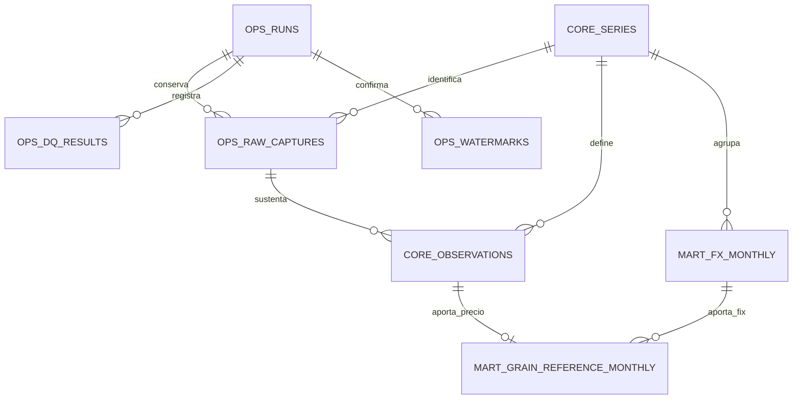

# Modelo de datos y contrato de publicación

## 1. Estado y fundamento

Este documento define el diseño para PostgreSQL del proyecto. Se confirmó la preparación de la base del proyecto y la ejecución histórica real con los resultados esperados. El histórico y el incremental conectan extracción, perfil y publicación hasta Gold mediante comandos independientes. Ambos se verificaron con HTTP simulado y PostgreSQL aislado.

El diseño se apoya en el [perfilamiento inicial](Perfilamiento_inicial.md): cuatro series identificadas, nueve precios mensuales y 21 registros FIX diarios, fechas únicas por serie y valores con hasta 13 posiciones decimales en FRED y cuatro en FIX. Una [validación posterior de calendario y Gold](GUIA_CALENDARIO_Y_GOLD_ES.md) certificó el FIX de septiembre de 2026 y calculó sus tres referencias. La [publicación](GUIA_PUBLICACION_GOLD_ES.md) se verificó después en bases desechables. La confirmación del histórico real se registra en la bitácora, separada de las evidencias de pruebas simuladas.

El detalle de campos se encuentra en el [diccionario de datos](DICCIONARIO_DATOS_ES.md) y los controles se especifican en el [catálogo de calidad](REGLAS_CALIDAD_ES.md).

## 2. Capas, esquemas y granularidad

| Capa o función | Ubicación implementada | Granularidad |
|---|---|---|
| Bronze | Archivos JSON y `ops.raw_captures` | Una captura identificada por ejecución, fuente, tipo y ventana. |
| Catálogo | `core.series` | Una serie de un proveedor. |
| Silver | `core.observations` | Una observación vigente por proveedor, serie y fecha. |
| Gold: tipo de cambio | `mart.fx_monthly` | Un mes de una serie FIX con cobertura validada. |
| Gold: referencias | `mart.grain_reference_monthly` | Un mes de un grano, con entradas de cálculo y referencia en MXN/t. |
| Control | `ops.runs`, `ops.dq_results`, `ops.watermarks` | Una ejecución, sus verificaciones y el avance publicado del producto. |
| Versión SQL | `ops.schema_migrations` | Una versión del esquema aplicada, control técnico adicional a las ocho entidades del modelo. |

Bronze conserva el contenido JSON interpretado de origen en archivos, manteniendo los textos numéricos recibidos, no conserva los bytes del cuerpo HTTP. El registro de capturas en PostgreSQL permite localizar cada archivo y verificar su integridad. Silver contiene valores tipados y validados. Gold relaciona las frecuencias mediante el mes. Los esquemas organizan las tablas por función, las carpetas Python separan consulta, reglas, transformación, persistencia y coordinación.



El diagrama resume las relaciones principales. Las claves completas, las dos referencias de ejecución del watermark y las relaciones de auditoría se detallan en el diccionario. Las entidades se representan como `ESQUEMA_TABLA`.

## 3. Identificación y actualización de observaciones

La clave de `core.series` es `(provider, series_code)`. La clave de `core.observations` añade `observation_date`. Así, una fecha puede repetirse entre granos o proveedores y conservar su significado dentro de cada serie.

Por ejemplo, `FRED / PMAIZMTUSDM / 2026-09-01` identifica una sola observación mensual de maíz. Una segunda extracción de ese registro actualiza la misma fila si cambió su valor. Si el valor permanece igual, la fila vigente se conserva. El intento y su captura se registran de todas formas en `ops`.

Se mantienen la ejecución y el instante de creación de la fila, y la ejecución, captura e instante de su última modificación. Las capturas previas conservan la evidencia de valores anteriores. La tabla Silver representa el estado vigente, reconstruir versiones anteriores requiere Bronze y los registros operativos.

La función de escritura Silver ya aplica esta regla mediante una actualización condicionada al cambio del valor. Verifica catálogo, captura, hash, contexto e intervalo del intento antes de preparar y escribir. La [guía de persistencia Silver](GUIA_PERSISTENCIA_SILVER_ES.md) detalla las comprobaciones y los límites transaccionales.

Las claves primarias evitan duplicados y las claves foráneas relacionan observaciones, catálogo y procedencia. Esas claves y las restricciones de fila están implementadas en el SQL inicial. Las reglas que requieren comparar conjuntos o consultar otras tablas se ejecutan en la carga. [Restricciones de PostgreSQL](https://www.postgresql.org/docs/current/ddl-constraints.html).

## 4. Fechas, unidades y precisión

La fecha de observación tiene tipo `DATE`. En FRED, el primer día identifica todo el periodo mensual, en FIX identifica el día de determinación. La unidad y la frecuencia proceden del catálogo validado. Un cambio incompatible en los metadatos detiene la carga antes de reinterpretar valores almacenados.

Los instantes de captura, carga y ejecución utilizan `TIMESTAMPTZ`. Se registran como instantes UTC y se presentan en la zona que corresponda. `America/Mexico_City` determina el día de operación y el cierre de mes. `TIMESTAMPTZ` conserva el instante, la identificación de esta zona operativa pertenece a la configuración. [Fechas y horas de PostgreSQL](https://www.postgresql.org/docs/current/datatype-datetime.html).

Los valores de origen se almacenan como `NUMERIC` sin una escala declarada que fuerce su redondeo. La validación exige números finitos y positivos. Esta elección conserva la precisión capturada y evita limitar el histórico a los decimales de la muestra. [Tipos numéricos de PostgreSQL](https://www.postgresql.org/docs/current/datatype-numeric.html).

Las transformaciones implementan un contexto decimal de 34 dígitos significativos y redondeo `ROUND_HALF_EVEN`. La media FIX se calcula primero y la referencia utiliza esa misma media. Las comparaciones DQ repiten la misma política. El redondeo para presentación se aplica al mostrar resultados. Se verificó que el contexto local restaura el entorno del llamador y que la configuración decimal externa no modifica los resultados. [Contextos decimales de Python](https://docs.python.org/3.12/library/decimal.html#context-objects).

## 5. Integración mensual y resultados Gold

Para cada mes, el conjunto de fechas FIX válidas debe coincidir con el calendario hábil bancario aplicable. Se conservan el número observado, el esperado y una referencia a la evidencia del calendario. Las coincidencias de conteo por sí solas no sustituyen la comparación de fechas.

La lectura anual, la comparación y el agregado están implementados en módulos separados. Las referencias incorporadas cubren 2009–2026, con versión, SHA-256 y procedencia documentada. Un año sin recurso revisado impide el histórico y el agregado. La persistencia escribe los resultados en la transacción de publicación y conserva filas y auditoría cuando sus valores no cambian.

La convención analítica es la media aritmética de los valores FIX diarios válidos de ese mes:

```text
average_fix = suma de FIX de los días esperados / cantidad de días esperados
reference_mxn_t = grain_price_usd_t × average_fix
```

Esta convención produce una referencia mensual compatible con la frecuencia disponible de los granos. El indicador relaciona precio internacional y tipo de cambio para el análisis, no reproduce una operación comercial individual ni establece causalidad por sí mismo.

`mart.grain_reference_monthly` conserva el precio USD/t, la media FIX MXN/USD y el resultado MXN/t. También incluye variaciones porcentuales mensual y anual de la referencia:

```text
mom_change_pct = (referencia del mes / referencia del mes anterior - 1) × 100
yoy_change_pct = (referencia del mes / referencia del mismo mes del año anterior - 1) × 100
```

Cuando el periodo de comparación queda fuera del histórico publicado, la variación es `NULL`. Se utilizan los periodos exactos, sin sustituirlos por el último registro disponible. Las variaciones pueden ser cero o negativas, la regla de positividad corresponde a precios, FIX y referencias.

Una revisión de un mes obliga a recalcular sus resultados dependientes. La implementación reconstruye el intervalo publicado completo para conservar los comparadores anteriores y modifica únicamente las filas Gold que cambian. Esto incluye las referencias revisadas y las variaciones posteriores afectadas. Si una revisión altera fechas o valores FIX, se repite su validación de cobertura.

## 6. Ejecuciones, calidad y procedencia

`ops.runs` identifica cada intento histórico o incremental, su etapa y su estado. El reproceso usa `load_type = historical` y se distingue mediante `CTL-05.operation = reprocess`, la recuperación conserva la modalidad de origen en un intento nuevo. El diagnóstico de muestras es un comando separado, sus archivos son evidencia de exploración y no inicializan el control de producción.

Los estados de ejecución son `running`, `succeeded`, `failed` y `skipped`. `succeeded` requiere una publicación confirmada. `skipped` registra un incremental sin ventana seleccionada y con revisión desactivada, después de comprobar el histórico, la disponibilidad declarada de su último mes y la integridad Silver/Gold. Se conserva en `planning` con intervalo nulo y no modifica el watermark. La recuperación explícita obtiene el bloqueo del producto antes de cerrar un huérfano `running`, publica mediante un intento nuevo, sin reabrir estados terminados.

`ops.raw_captures` registra la ruta, el SHA-256 y el contexto de cada captura. La observación publicada debe corresponder a una captura de observaciones de la misma serie. El hash verifica la integridad del archivo usado al procesar o reconstruir datos.

`ops.dq_results` conserva cada regla aplicada y sus métricas con estados `passed`, `failed` o `pending`. Las reglas obligatorias pendientes impiden publicar, igual que las fallidas. Los errores se almacenan como mensajes controlados, sin credenciales ni URLs autenticadas.

## 7. Watermark y publicación

Se define un watermark común al producto `grain_reference_mxn`. Su intervalo va desde `start_month` hasta `published_through_month`, ambos identificados con el primer día del mes. Cada mes incluido debe tener los tres granos, el FIX certificado y sus referencias Gold. Los resultados DQ y las capturas mantienen el detalle por fuente.

La primera fila de watermark se crea únicamente cuando termina satisfactoriamente una carga histórica hasta Gold. El incremental exige esa inicialización y determina los meses nuevos desde el avance publicado. Incluye por defecto los últimos tres meses publicados para detectar revisiones, `--review-months` permite seleccionar entre cero y doce. El mes candidato debe estar cerrado y declarado por todas las fuentes. `--end-month` permite limitarlo sin retroceder antes del watermark. Las correcciones anteriores a la revisión seleccionada requieren un reproceso explícito.

La actualización de Silver, Gold, watermark y estado de éxito pertenece a una misma transacción de publicación. Se verificaron la visibilidad desde otra sesión y la reversión tras fallos posteriores a las escrituras. [Transacciones de PostgreSQL](https://www.postgresql.org/docs/current/tutorial-transactions.html).

El registro inicial del intento, sus capturas y sus resultados DQ se confirman antes y fuera de esa transacción, para conservar el diagnóstico cuando una publicación falla. Después de un fallo se revierte la publicación y se registra el error en una transacción separada. Los archivos Bronze permanecen disponibles.

Las publicaciones del mismo producto se serializan mediante un bloqueo de sesión que permanece adquirido entre transacciones. Ambos coordinadores mantienen ese ámbito desde la planificación y dejan la conexión SQL sin transacción abierta durante las peticiones HTTP. La contención se rechaza sin espera indefinida. Se comprobaron su duración y su liberación ante errores.

Un reproceso de un intervalo ya publicado conserva los límites vigentes y actualiza los resultados afectados. Cualquier ampliación del intervalo debe mantener continuidad. El watermark no retrocede ni avanza por recibir metadatos o completar únicamente Silver.

## 8. Contratos de las cargas y operación

| Proceso | Entrada y condición inicial | Resultado exigido |
|---|---|---|
| Histórico | Mes inicial y final explícitos, compatibles con las fuentes, controles del periodo completo. | Capturas, Silver, Gold y creación del estado inicial tras una publicación satisfactoria. |
| Incremental | Watermark inicializado, meses nuevos y revisión delimitada de periodos anteriores. | Actualización hasta Gold, sin duplicados y con avance confirmado únicamente al publicar. |
| Reproceso histórico | Intervalo explícito y validación completa de sus dependencias. | Corrección de filas y recálculo de Gold, conservando la evidencia y la continuidad del intervalo publicado. |

Ambas cargas reutilizan extracción, calidad, transformación y persistencia mediante coordinadores independientes. El histórico inicial exige ausencia de watermark y recibe sus meses explícitos. Se definió el intervalo 2009-01 a 2026-09, sus referencias bancarias están incorporadas. El incremental consulta únicamente su ventana de revisión y meses nuevos, y utiliza todo Silver validado para reconstruir Gold y sus comparadores. El [comando de reproceso](GUIA_RECUPERACION_Y_REPROCESOS_ES.md) reconsulta meses dentro del intervalo vigente sin ampliar sus límites. La recuperación reutiliza originales completos, salvo que exista una publicación posterior al intento.

El [dashboard](ANALISIS_Y_DASHBOARD_ES.md) consulta el watermark y Gold en una instantánea de solo lectura y aislamiento repetible. Comprueba meses comunes, unidades, cobertura, referencias y comparadores antes de presentar indicadores, no modifica las capas ni el control.

El SQL y los comandos de preparación están descritos en la [guía PostgreSQL](GUIA_POSTGRESQL_ES.md). Las evidencias de las etapas previas conservan sus resultados originales. La suite final alcanzó [254 pruebas aprobadas, incluidas 91 SQL](evidencias/entrega_final/validacion.json), sin omisiones. El preflight del wheel y la exportación analítica verificaron además el producto real mediante lecturas, sin modificar sus tablas. La [automatización](GUIA_AUTOMATIZACION_ES.md) programa únicamente el incremental instalado, no añade entidades ni modifica el SQL inicial.
