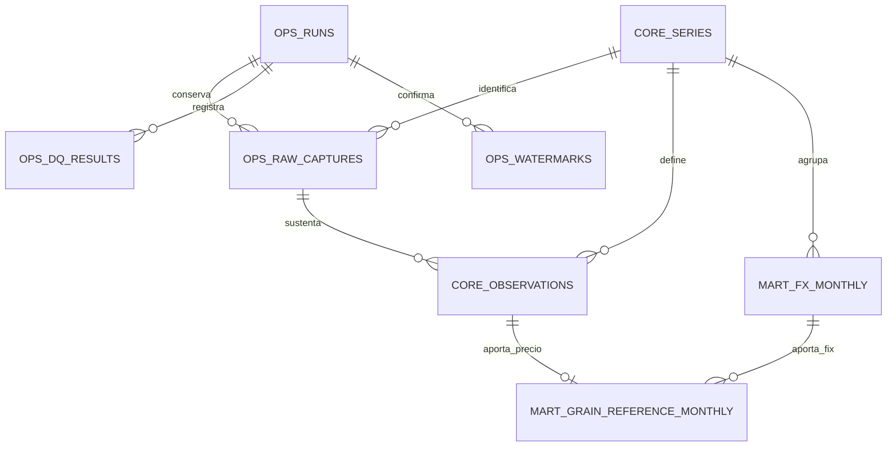

# Modelo de datos y contrato de publicación

## 1. Estado y fundamento

La creación de tablas y los procesos de persistencia se implementarán en el siguiente avance. Las entidades y garantías descritas aquí constituyen el contrato que deberá cumplir esa implementación.

El diseño se apoya en el [perfilamiento inicial](Perfilamiento_inicial.md): cuatro series identificadas, nueve precios mensuales y 21 registros FIX diarios, fechas únicas por serie y valores con hasta 13 posiciones decimales en FRED y cuatro en FIX. La muestra comprobó esos registros y la cobertura bancaria y el histórico completo permanecen pendientes.

El detalle de campos se encuentra en el [diccionario de datos](DICCIONARIO_DATOS_ES.md) y los controles se especifican en el [catálogo de calidad](REGLAS_CALIDAD_ES.md).

## 2. Capas, esquemas y granularidad

| Capa o función | Ubicación propuesta | Granularidad |
|---|---|---|
| Bronze | Archivos JSON y `ops.raw_captures` | Una captura identificada por ejecución, fuente, tipo y ventana. |
| Catálogo | `core.series` | Una serie de un proveedor. |
| Silver | `core.observations` | Una observación vigente por proveedor, serie y fecha. |
| Gold: tipo de cambio | `mart.fx_monthly` | Un mes de una serie FIX con cobertura validada. |
| Gold: referencias | `mart.grain_reference_monthly` | Un mes de un grano, con entradas de cálculo y referencia en MXN/t. |
| Control | `ops.runs`, `ops.dq_results`, `ops.watermarks` | Una ejecución, sus verificaciones y el avance publicado del producto. |
| Versión SQL | `ops.schema_migrations` | Una versión del esquema aplicada, control técnico adicional a las ocho entidades del modelo. |

Bronze conserva el contenido de origen en archivos. El registro de capturas en PostgreSQL permitirá localizar cada archivo y verificar su integridad. Silver contiene valores tipados y validados. Gold relaciona las frecuencias mediante el mes. Los esquemas organizan las tablas por función, las carpetas Python continuarán separando consulta, reglas, transformación, persistencia y coordinación.



El diagrama resume las relaciones principales. Las claves completas, las dos referencias de ejecución del watermark y las relaciones de auditoría se detallan en el diccionario. Las entidades se representan como `ESQUEMA_TABLA`.

## 3. Identificación y actualización de observaciones

La clave de `core.series` será `(provider, series_code)`. La clave de `core.observations` añadirá `observation_date`. Así, una fecha puede repetirse entre granos o proveedores y conservar su significado dentro de cada serie.

Por ejemplo, `FRED / PMAIZMTUSDM / 2026-09-01` identifica una sola observación mensual de maíz. Una segunda extracción de ese registro deberá actualizar la misma fila si cambió su valor. Si el valor permanece igual, la fila vigente se conservará. El intento y su captura se registrarán de todas formas en `ops`.

Se mantendrán la ejecución y el instante de creación de la fila, y la ejecución, captura e instante de su última modificación. Las capturas previas conservarán la evidencia de valores anteriores. La tabla Silver representará el estado vigente y la reconstrucción de versiones anteriores utilizará Bronze y los registros operativos.

Las claves primarias evitan duplicados y las claves foráneas relacionan observaciones, catálogo y procedencia. Esas claves y las restricciones de fila están implementadas en el SQL inicial. Las reglas que requieren comparar conjuntos o consultar otras tablas se ejecutarán en la carga. [Restricciones de PostgreSQL](https://www.postgresql.org/docs/current/ddl-constraints.html).

## 4. Fechas, unidades y precisión

La fecha de observación tendrá tipo `DATE`. En FRED, el primer día identifica todo el periodo mensual; en FIX identifica el día de determinación. La unidad y la frecuencia proceden del catálogo validado. Un cambio incompatible en los metadatos deberá detener la carga antes de reinterpretar valores almacenados.

Los instantes de captura, carga y ejecución utilizarán `TIMESTAMPTZ`. Se registrarán como instantes UTC y se presentarán en la zona que corresponda. `America/Mexico_City` seguirá determinando el día de operación y el cierre de mes. `TIMESTAMPTZ` conserva el instante, la identificación de esta zona operativa pertenece a la configuración. [Fechas y horas de PostgreSQL](https://www.postgresql.org/docs/current/datatype-datetime.html).

Los valores de origen se almacenarán como `NUMERIC` sin una escala declarada que fuerce su redondeo. La validación exigirá números finitos y positivos. Esta elección conserva la precisión capturada y evita limitar el histórico a los decimales de la muestra. [Tipos numéricos de PostgreSQL](https://www.postgresql.org/docs/current/datatype-numeric.html).

Para las transformaciones se define un contexto decimal de 34 dígitos significativos y redondeo `ROUND_HALF_EVEN`. La media FIX se calculará primero y la referencia utilizará esa media almacenada. Las comparaciones DQ repetirán la misma política. El redondeo para presentación se aplicará al mostrar resultados. Esta política se implementará y verificará al construir las transformaciones, mediante un contexto local que restaure el entorno de cálculo al terminar. [Contextos decimales de Python](https://docs.python.org/3.12/library/decimal.html#context-objects).

## 5. Integración mensual y resultados Gold

Para cada mes, el conjunto de fechas FIX válidas deberá coincidir con el calendario hábil bancario aplicable. Se conservarán el número observado, el esperado y una referencia a la evidencia del calendario. Las coincidencias de conteo por sí solas no sustituyen la comparación de fechas.

La convención analítica será la media aritmética de los valores FIX diarios válidos de ese mes:

```text
average_fix = suma de FIX de los días esperados / cantidad de días esperados
reference_mxn_t = grain_price_usd_t × average_fix
```

Esta convención produce una referencia mensual compatible con la frecuencia disponible de los granos. El indicador relaciona precio internacional y tipo de cambio para el análisis, no reproduce una operación comercial individual ni establece causalidad por sí mismo.

`mart.grain_reference_monthly` conservará el precio USD/t, la media FIX MXN/USD y el resultado MXN/t. También incluirá variaciones porcentuales mensual y anual de la referencia:

```text
mom_change_pct = (referencia del mes / referencia del mes anterior - 1) × 100
yoy_change_pct = (referencia del mes / referencia del mismo mes del año anterior - 1) × 100
```

Cuando el periodo de comparación quede fuera del histórico publicado, la variación será `NULL`. Se utilizarán los periodos exactos, sin sustituirlos por el último registro disponible. Las variaciones pueden ser cero o negativas; la regla de positividad corresponde a precios, FIX y referencias.

Una revisión de un mes obliga a recalcular sus resultados dependientes. Se reconstruirá Gold desde el primer mes modificado hasta el último publicado, incluyendo las variaciones, dentro de la misma publicación. Si una revisión altera fechas o valores FIX, se repetirá además su validación de cobertura.

## 6. Ejecuciones, calidad y procedencia

`ops.runs` identificará cada intento histórico o incremental, su etapa y su estado. El diagnóstico de muestras continuará siendo un comando separado; sus archivos existentes son evidencia de exploración y no inicializan el control de producción.

Los estados de ejecución serán `running`, `succeeded`, `failed` y `skipped`. `succeeded` requiere una publicación confirmada, `skipped` permitirá registrar un incremental sin trabajo después de comprobar que existe una carga inicial válida. Una ejecución que queda en `running` tras una interrupción requerirá revisión de recuperación.

`ops.raw_captures` registrará la ruta, el SHA-256 y el contexto de cada captura. La observación publicada deberá corresponder a una captura de observaciones de la misma serie. El hash verificará la integridad del archivo usado al procesar o reconstruir datos.

`ops.dq_results` conservará cada regla aplicada y sus métricas con estados `passed`, `failed` o `pending`. Las reglas obligatorias pendientes impedirán publicar, igual que las fallidas. Los errores se almacenarán como mensajes controlados, sin credenciales ni URLs autenticadas.

## 7. Watermark y publicación

Se define un watermark común al producto `grain_reference_mxn`. Su intervalo irá desde `start_month` hasta `published_through_month`, ambos identificados con el primer día del mes. Cada mes incluido deberá tener los tres granos, el FIX certificado y sus referencias Gold. Los resultados DQ y las capturas mantendrán el detalle por fuente.

La primera fila de watermark se creará únicamente cuando termine satisfactoriamente una carga histórica hasta Gold. El incremental exigirá esa inicialización y a partir de ella determinará los meses nuevos. La revisión de periodos anteriores utilizará un solapamiento explícito cuyo alcance se fijará al implementar el incremental. Las correcciones más antiguas requerirán un reproceso explícito.

La actualización de Silver, Gold, watermark y estado de éxito pertenecerá a una misma transacción de publicación. PostgreSQL permite confirmar o revertir ese conjunto como una unidad. [Transacciones de PostgreSQL](https://www.postgresql.org/docs/current/tutorial-transactions.html).

El registro inicial del intento, sus capturas y sus resultados DQ se confirmarán antes y fuera de esa transacción, para conservar el diagnóstico cuando una publicación falle. Después de un fallo se revertirá la publicación y se registrará el error en una transacción separada. Los archivos Bronze permanecerán disponibles.

Las publicaciones del mismo producto se serializarán. El mecanismo de bloqueo deberá impedir que otra ejecución cambie el estado usado para planear mientras se publica una carga. Se implementará con la persistencia y se comprobará al desarrollar el incremental.

Un reproceso de un intervalo ya publicado conservará los límites vigentes y actualizará los resultados afectados. Cualquier ampliación del intervalo deberá mantener continuidad. El watermark no retrocederá ni avanzará por recibir metadatos o completar únicamente Silver.

## 8. Contratos de las cargas y siguiente implementación

| Proceso | Entrada y condición inicial | Resultado exigido |
|---|---|---|
| Histórico | Mes inicial y final explícitos, compatibles con las fuentes; controles del periodo completo. | Capturas, Silver, Gold y creación del estado inicial tras una publicación satisfactoria. |
| Incremental | Watermark inicializado, meses nuevos y revisión delimitada de periodos anteriores. | Actualización hasta Gold, sin duplicados y con avance confirmado únicamente al publicar. |
| Reproceso histórico | Intervalo explícito y validación completa de sus dependencias. | Corrección de filas y recálculo de Gold, conservando la evidencia y la continuidad del intervalo publicado. |
